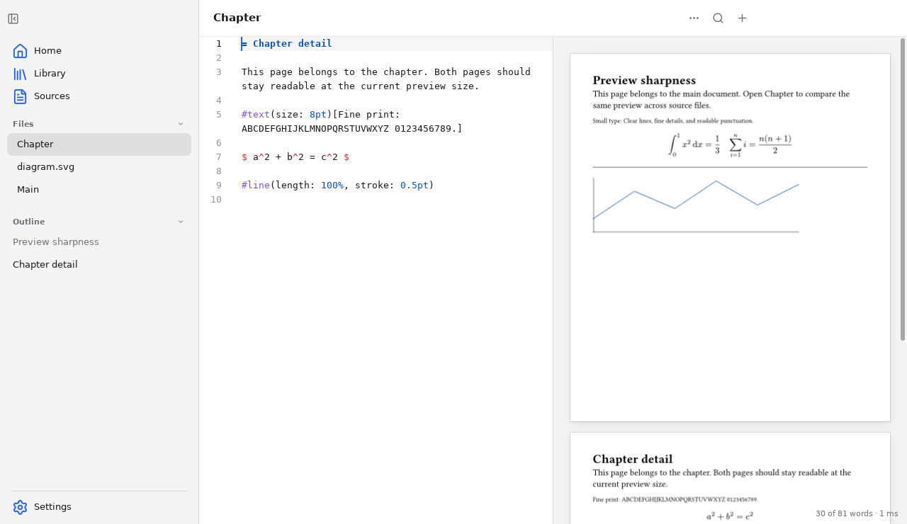

# Preview regression testing

The preview fits pages to the pane width. It has no separate PDF zoom control.
Resize the window or drag the editor divider to change the fitted page size.
PDF export uses Typst's compiled document, not the preview bitmaps.

## Run the automated checks

Run the full check suite:

```sh
scripts/check.sh
```

For a focused regression run, use:

```sh
go test -race ./internal/app/document -run TestPreview -count=3
```

These tests compile real Typst documents through the application session. They cover:

- Raster dimensions for both the open file and included files.
- Window resizing and simulated display scales of 1, 1.25, 2, and 3.
- Rejection of obsolete raster results, including callbacks queued before closing.
- Bitmap reuse for unchanged pages and replacement after content edits.
- Raster budgets, scrolling, eviction, and preservation of page geometry.
- Unmeasured and invalid render targets.

Simulated display scales do not establish behavior on physical Retina hardware.

## Run the native Linux check

Use a disposable desktop session with `xdotool`, `wmctrl`, and Python with Pillow installed.
The automation plugin is included only in the opt-in `e2e` build.

1. Build the native application:

   ```sh
   scripts/build-typst.sh
   go build -tags e2e -o /tmp/thesio-preview .
   ```

2. Start the regression runner:

   ```sh
   python3 scripts/test-preview.py --binary /tmp/thesio-preview --display :1
   ```

The runner creates a uniquely named temporary vault containing headings, body text,
small text, equations, a vector diagram, and thin lines. It isolates application
configuration and caches from your normal session.

It opens **Main** and **Chapter**, scrolls to the same preview page, and compares
native captures at approximately 78%, 100%, 113%, 95%, and 183% fitted sizes.
It verifies the actual window dimensions, waits for pending raster work, and checks
that clicking the main page from **Chapter** opens its source in **Main**.

The runner prints the fixture, evidence, socket, and process paths. It leaves the
application open for independent visual inspection. A subsequent run replaces only
the disposable process recorded in `/tmp/thesio-preview-session.json`.
Use `--state` to keep that record elsewhere.

To capture an older binary without requiring it to pass the image comparison, add
`--no-assert --label baseline`. Compare captures with the same window size and pane width.

The native runner uses a 1x Linux desktop. Its screenshots do not verify macOS,
Windows, or physical high-density displays.

## Compare native captures

These captures show the same disposable document with **Chapter** open on a 1x Linux desktop.
The pane displays the main page at approximately 113% of its Typst dimensions.

Before the fix, the main page is enlarged from a 200 × 230-pixel thumbnail:


After the fix, the main page uses a 452 × 520-pixel raster:



## Inspect the result

1. Select **Chapter** in the sidebar.
2. Scroll the preview to the first page, headed “Preview sharpness.”
3. Inspect the body text, small text, equations, diagram, and thin line.
4. Select **Main** and compare that same page at the same pane width.
5. Resize the window and drag the editor divider to enlarge the preview.

Pages from other files must remain readable rather than become enlarged thumbnails.
During resizing, the previous bitmap can appear briefly while a replacement renders.
Pages outside the retained viewport region appear as white placeholders until rendered.
Extreme page sizes and display scales remain subject to the documented raster limits.
